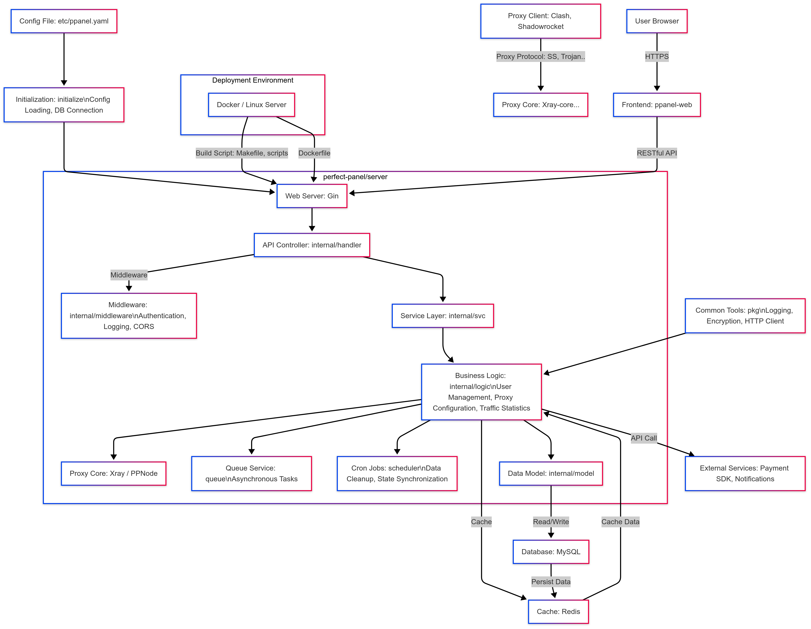

# Alpha Server

<div align="center">

[](LICENSE)
[](https://go.dev/)
[](https://goreportcard.com/report/github.com/neibniz/alpha/server)
[](Dockerfile)
[](../.github/workflows/server.yml)

**Alpha is a pure, professional, and perfect open-source proxy panel tool, designed for learning and practical use.**

[English](README.md) | [中文](readme_zh.md) | [Report Bug](https://github.com/neibniz/alpha/issues/new) | [Request Feature](https://github.com/neibniz/alpha/issues/new)

## 📋 Overview

Alpha Server is the backend component of the Alpha project, providing robust APIs and core functionality for managing
proxy services. Built with Go, it emphasizes performance, security, and scalability.

### Key Features

- **Multi-Protocol Support**: Supports Shadowsocks, V2Ray, Trojan, and more.
- **Privacy Controls**: Supports encrypted private fields, masked log views, and explicit retention policies.
- **Minimalist Design**: Simple yet powerful, with complete business logic.
- **User Management**: Full authentication and authorization system.
- **Subscription System**: Manage user subscriptions and service provisioning.
- **Payment Integration**: Supports multiple payment gateways.
- **Order Management**: Track and process user orders.
- **Ticket System**: Built-in customer support and issue tracking.
- **Node Management**: Monitor and control server nodes.
- **API Framework**: Comprehensive RESTful APIs for frontend integration.

## 🚀 Quick Start

### Prerequisites

- **Go**: 1.26.5 (the toolchain pinned by `go.mod`)
- **Docker**: Optional, for containerized deployment
- **Git**: For cloning the repository

### Installation from Source

1. **Clone the repository**:
   ```bash
   git clone https://github.com/neibniz/alpha.git
   cd alpha/server
   ```

2. **Install dependencies**:
   ```bash
   go mod download
   ```

3. **Generate code**:
   ```bash
   chmod +x script/generate.sh
   ./script/generate.sh
   ```

4. **Build the project**:
   ```bash
   make linux-amd64
   ```

5. **Run the server**:
   ```bash
   ./alpha-server-linux-amd64 run --config etc/alpha.yaml
   ```

### Docker Compose Deployment

The maintained Linux single-host example starts Server, PostgreSQL, Redis, and
single-node ClickHouse with loopback-only listeners, read-only secret mounts,
health-gated startup, and bounded container logs.

```bash
cp .env.compose.example .env
cp etc/alpha.compose.example.yaml etc/alpha.compose.yaml
```

Follow the complete [Docker Compose deployment guide](doc/docker-compose.md)
before running `docker compose up -d`. The guide covers secret generation,
initial migrations, reverse proxying, health checks, upgrades, rollback, and
backups. A [Chinese guide](doc/docker-compose-zh.md) is also available.

GitHub Actions publishes Linux AMD64 and ARM64 images to
`ghcr.io/neibniz/alpha-server`. Pin a release tag or digest in production. The
image already contains a checksum-verified GeoIP database and does not download
it during container startup.

## 📖 API Documentation

Explore the full API documentation:

- **Swagger**: [https://alpha.dev/en-US/swagger/alpha](https://alpha.dev/swagger/alpha)

The documentation covers all endpoints, request/response formats, and authentication details.

## 🔗 Related Projects

| Project          | Description                | Link                                                  |
|------------------|----------------------------|-------------------------------------------------------|
| Alpha Web       | Frontend for Alpha        | [GitHub](https://github.com/neibniz/alpha/tree/main/frontend) |
| Alpha User Web  | User interface for Alpha  | [Preview](https://user.alpha.dev)                    |
| Alpha Admin Web | Admin interface for Alpha | [Preview](https://admin.alpha.dev)                   |

## 🌐 Official Website

Visit [alpha.dev](https://alpha.dev/) for more details.

## 🏛 Architecture



## 📁 Directory Structure

```
.
├── apis/             # API definition files
├── cmd/              # Application entry point
├── doc/              # Documentation
├── etc/              # Configuration files (e.g., alpha.yaml)
├── generate/         # Code generation tools
├── initialize/       # System initialization
├── internal/         # Internal modules
│   ├── config/       # Configuration parsing
│   ├── handler/      # HTTP handlers
│   ├── middleware/   # HTTP middleware
│   ├── logic/        # Business logic
│   ├── model/        # Data models
│   ├── svc/          # Service layer
│   └── types/        # Type definitions
├── pkg/              # Utility code
├── queue/            # Queue services
├── scheduler/        # Scheduled tasks
├── script/           # Build scripts
├── go.mod            # Go module definition
├── Makefile          # Build automation
└── Dockerfile        # Docker configuration
```

## 💻 Development

### Format API Files
```bash
goctl api format --dir apis/user.api
```

### Add a New API

1. Create a new API file in `apis/`.
2. Import it in `apis/alpha.api`.
3. Regenerate code:
   ```bash
   ./script/generate.sh
   ```

### Build for Multiple Platforms

Use the `Makefile` to build for various platforms (e.g., Linux, Windows, macOS):

```bash
make all  # Builds linux-amd64, darwin-amd64, windows-amd64
make linux-arm64  # Build for specific platform
```

Supported platforms include:

- Linux: `386`, `amd64`, `arm64`, `armv5-v7`, `mips`, `riscv64`, `loong64`, etc.
- Windows: `386`, `amd64`, `arm64`, `armv7`
- macOS: `amd64`, `arm64`
- FreeBSD: `amd64`, `arm64`

## 🤝 Contributing

Contributions are welcome! Please follow the [Contribution Guidelines](CONTRIBUTING.md) for bug fixes, features, or
documentation improvements.

## ✨ Special Thanks

A huge thank you to the following outstanding open-source projects that have provided invaluable support for this
project's development! 🚀

<div style="overflow-x: auto;">
<table style="width: 100%; border-collapse: collapse; margin: 20px 0;">
  <thead>
    <tr style="background-color: #f5f5f5;">
      <th style="padding: 10px; text-align: center;">Project</th>
      <th style="padding: 10px; text-align: left;">Description</th>
      <th style="padding: 10px; text-align: center;">Project</th>
      <th style="padding: 10px; text-align: left;">Description</th>
    </tr>
  </thead>
  <tbody>
    <tr>
      <td align="center" style="padding: 15px; vertical-align: middle;">
        <a href="https://gin-gonic.com/" style="text-decoration: none;">
          <br/>
          <strong>Gin</strong><br/>
          
        </a>
      </td>
      <td style="padding: 15px; vertical-align: middle;">
        High-performance Go Web framework<br/>
      </td>
      <td align="center" style="padding: 15px; vertical-align: middle;">
        <a href="https://gorm.io/" style="text-decoration: none;">
          <br/>
          <strong>Gorm</strong><br/>
          
        </a>
      </td>
      <td style="padding: 15px; vertical-align: middle;">
        Powerful Go ORM framework<br/>
      </td>
    </tr>
    <tr>
      <td align="center" style="padding: 15px; vertical-align: middle;">
        <a href="https://github.com/hibiken/asynq" style="text-decoration: none;">
          <br/>
          <strong>Asynq</strong><br/>
          
        </a>
      </td>
      <td style="padding: 15px; vertical-align: middle;">
        Asynchronous task queue for Go<br/>
      </td>
      <td align="center" style="padding: 15px; vertical-align: middle;">
        <a href="https://goswagger.io/" style="text-decoration: none;">
          <br/>
          <strong>Go-Swagger</strong><br/>
          
        </a>
      </td>
      <td style="padding: 15px; vertical-align: middle;">
        Comprehensive Go Swagger toolkit<br/>
      </td>
    </tr>
    <tr>
      <td align="center" style="padding: 15px; vertical-align: middle;">
        <a href="https://go-zero.dev/" style="text-decoration: none;">
          <br/>
          <strong>Go-Zero</strong><br/>
          
        </a>
      </td>
      <td colspan="3" style="padding: 15px; vertical-align: middle;">
        Go microservices framework (this project's API generator is built on Go-Zero)<br/>
      </td>
    </tr>
  </tbody>
</table>
</div>

---

🎉 **Salute to Open Source**: Thank you to the open-source community for making development simpler and more efficient!
Please give these projects a ⭐ to support the open-source movement!
## 📄 License

This project is licensed under the [GPL-3.0 License](LICENSE).
